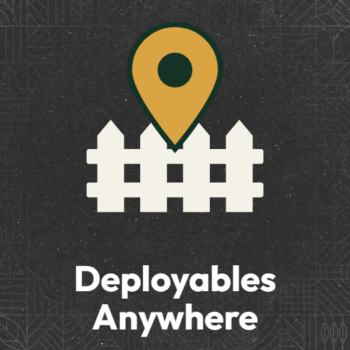

# ModHub upload: Deployables Anywhere

What to enter in the GIANTS ModHub upload form for this mod. Each text box below has a copy button on GitHub.



**Mod Icon (512x512):** [`icon_512.png`](icon_512.png)

| Field | Value |
|-------|-------|
| Title English | Deployables Anywhere |
| Title German | Überall Platzieren |
| Title French | Placer partout |
| Version | `1` `1` `2` `2` |
| Author | DTM Mods, Fennell |
| Manufacturer | Lizard |
| Category 1 | Gameplay |
| Category 2 | Not Set |
| Category 3 | Not Set |

## Title English
```text
Deployables Anywhere
```

## Title German
```text
Überall Platzieren
```

## Title French
```text
Placer partout
```

## Description English
```text
Description: Place buildings, decorations, fences and trees where the game says they cannot be placed, place them without flattening the ground, and position them precisely.
Hotkeys: in construction mode. Ctrl+Shift+P: free placement on/off. Ctrl+Shift+G: place without flattening the ground. Ctrl+Shift+Arrow keys: nudge 10 cm. Ctrl+Shift+PageUp/PageDown: raise/lower 5 cm. Ctrl+Shift+Comma/Period: rotate 1°. Ctrl+Shift+Backspace: reset. Controller: none by default, set them under Settings > Controls.
GitHub: https://github.com/DTM-Mods/FS25_DeployablesAnywhere

Free placement (Ctrl+Shift+P) is off by default, so nothing changes by accident. In construction mode, pick an item and press Ctrl+Shift+P; the F1 help shows whether it is on. While it is on, these checks are skipped: land you do not own, overlap with other objects, restricted, shop and spawn areas, water, the item's own "cannot be placed here" check, and blocked terrain leveling. The price at the cursor names the check that is skipped, for example "(free placement: Land is not owned by you)". Where leveling is blocked, the item is placed without flattening the ground. Still checked: money, building slots, your farm's build permission, and items that cannot be bought.

For buildings and decorations:
- Ctrl+Shift+G: place without flattening the ground (no leveling cost). Items on slopes keep the natural terrain.
- Ctrl+Shift+Arrow keys: nudge the item 10 cm away from/toward the camera or left/right. The first nudge locks the item in place, so the mouse no longer moves it.
- Ctrl+Shift+PageUp/PageDown: raise/lower 5 cm, without limit. Raised or lowered items are placed without flattening.
- Ctrl+Shift+Comma/Period: rotate 1°.
- Ctrl+Shift+Backspace: reset nudge, height and rotation.
Hold a key to repeat. Everything resets when you pick another item or leave construction mode.

Selling: your farm's buildings, decorations and fences can always be sold in construction mode (demolition mode, B), also on land you do not own. No key needed. Items of other farms and of the map cannot be sold. Removed fence segments and panels are refunded at what they cost to build; the base game pays nothing back for fences.

Install on the server and every client in multiplayer.
```

## Description German
```text
Beschreibung: Gebäude, Deko, Zäune und Bäume dort platzieren, wo das Spiel es nicht erlaubt, ohne Einebnen platzieren und Objekte genau ausrichten.
Tastenkombinationen: im Baumodus. Strg+Umschalt+P: freies Platzieren an/aus. Strg+Umschalt+G: ohne Einebnen platzieren. Strg+Umschalt+Pfeiltasten: 10 cm verschieben. Strg+Umschalt+Bild auf/Bild ab: 5 cm höher/tiefer. Strg+Umschalt+Komma/Punkt: um 1° drehen. Strg+Umschalt+Rücktaste: zurücksetzen. Controller: standardmäßig keine Belegung, unter Einstellungen > Steuerung festlegen.
GitHub: https://github.com/DTM-Mods/FS25_DeployablesAnywhere

Freies Platzieren (Strg+Umschalt+P) ist zunächst aus, damit nichts aus Versehen passiert. Im Baumodus ein Objekt wählen und Strg+Umschalt+P drücken; die F1-Hilfe zeigt den Zustand. Solange es an ist, entfallen diese Prüfungen: fremdes Land, Überschneidung mit anderen Objekten, gesperrte Bereiche, Shop- und Spawnbereiche, Wasser, die eigene "kann hier nicht platziert werden"-Prüfung des Objekts und blockierte Geländeanpassung. Am Preis beim Cursor steht, welche Prüfung entfällt. Wo die Geländeanpassung blockiert ist, wird ohne Einebnen platziert. Weiterhin geprüft: Geld, Bauplätze, die Baurechte deines Hofs und nicht kaufbare Objekte.

Für Gebäude und Deko:
- Strg+Umschalt+G: ohne Einebnen platzieren (keine Kosten für Geländeanpassung).
- Strg+Umschalt+Pfeiltasten: Objekt um 10 cm verschieben. Das erste Verschieben hält das Objekt fest, die Maus bewegt es dann nicht mehr.
- Strg+Umschalt+Bild auf/Bild ab: 5 cm höher/tiefer, ohne Grenze. Erhöhte oder abgesenkte Objekte werden ohne Einebnen platziert.
- Strg+Umschalt+Komma/Punkt: um 1° drehen.
- Strg+Umschalt+Rücktaste: Verschieben, Höhe und Drehung zurücksetzen.
Taste halten wiederholt. Alles wird zurückgesetzt, wenn ein anderes Objekt gewählt oder der Baumodus verlassen wird.

Verkaufen: Gebäude, Deko und Zäune deines Hofs lassen sich im Baumodus (Abrissmodus, B) immer verkaufen, auch auf fremdem Land. Ohne Taste. Objekte anderer Höfe und der Karte bleiben gesperrt. Entfernte Zaunabschnitte und -felder werden zum Baupreis erstattet; das Grundspiel erstattet für Zäune nichts.

Im Mehrspieler auf dem Server und allen Clients installieren.
```

## Description French
```text
Description : placez bâtiments, décorations, clôtures et arbres là où le jeu dit qu'ils ne peuvent pas être placés, placez-les sans aplanir le terrain et positionnez-les avec précision.
Raccourcis clavier : en mode construction. Ctrl+Maj+P : placement libre activé/désactivé. Ctrl+Maj+G : placer sans aplanir le terrain. Ctrl+Maj+Flèches : déplacer de 10 cm. Ctrl+Maj+Page haut/Page bas : monter/descendre de 5 cm. Ctrl+Maj+Virgule/Point : tourner de 1°. Ctrl+Maj+Retour arrière : réinitialiser. Manette : aucune touche par défaut, à définir dans Paramètres > Commandes.
GitHub : https://github.com/DTM-Mods/FS25_DeployablesAnywhere

Le placement libre (Ctrl+Maj+P) est désactivé par défaut : rien ne change par accident. En mode construction, choisissez un objet et appuyez sur Ctrl+Maj+P ; l'aide F1 indique s'il est actif. Tant qu'il est actif, ces vérifications sont ignorées : terrain qui ne vous appartient pas, chevauchement avec d'autres objets, zones interdites, zones de boutique et d'apparition, eau, la vérification « ne peut pas être placé ici » de l'objet lui-même et le nivellement bloqué. Le prix au curseur indique la vérification ignorée. Là où le nivellement est bloqué, l'objet est placé sans aplanir le terrain. Toujours vérifiés : l'argent, les emplacements de construction, le droit de construire de votre ferme et les objets non achetables.

Pour les bâtiments et les décorations :
- Ctrl+Maj+G : placer sans aplanir le terrain (aucun coût de nivellement). Sur une pente, le terrain naturel est conservé.
- Ctrl+Maj+Flèches : déplacer l'objet de 10 cm en s'éloignant/se rapprochant de la caméra ou vers la gauche/droite. Le premier déplacement fixe l'objet : la souris ne le déplace plus.
- Ctrl+Maj+Page haut/Page bas : monter/descendre de 5 cm, sans limite. Les objets montés ou descendus sont placés sans aplanir.
- Ctrl+Maj+Virgule/Point : tourner de 1°.
- Ctrl+Maj+Retour arrière : réinitialiser le déplacement, la hauteur et la rotation.
Maintenir une touche répète l'action. Tout est réinitialisé quand vous choisissez un autre objet ou quittez le mode construction.

Vente : les bâtiments, décorations et clôtures de votre ferme se vendent toujours en mode construction (mode démolition, B), même sur un terrain qui ne vous appartient pas. Aucune touche nécessaire. Les objets des autres fermes et de la carte ne peuvent pas être vendus. Les segments et panneaux de clôture retirés sont remboursés à leur coût de construction ; le jeu de base ne rembourse rien pour les clôtures.

En multijoueur, à installer sur le serveur et chez chaque joueur.
```

## Before uploading

- The mod itself has English and German texts only (modDesc and `translations/`); French players get the English key names and messages. The French texts here do not add French to the mod.
